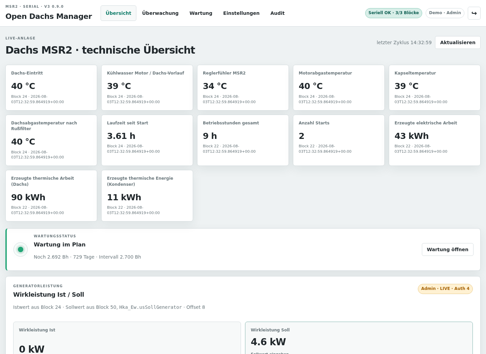
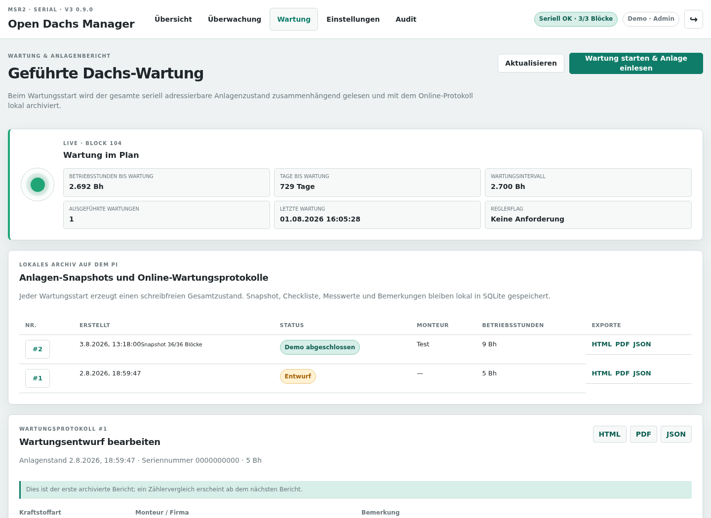
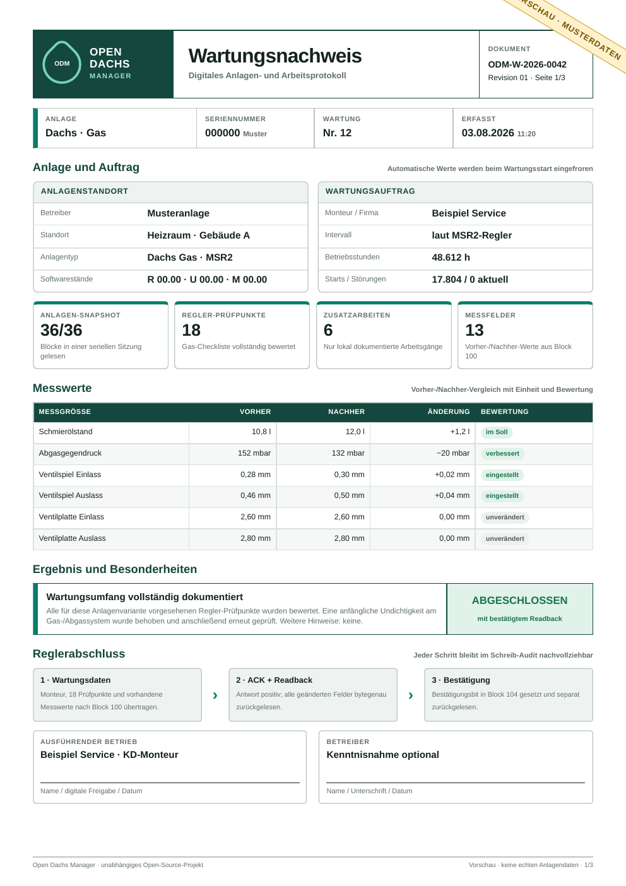
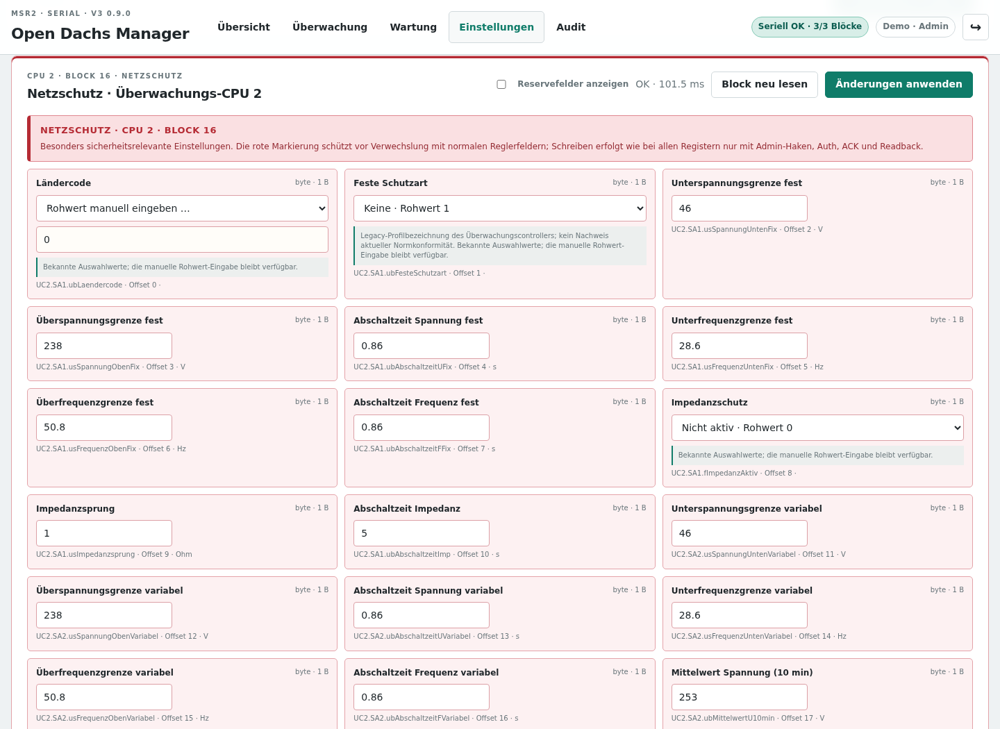
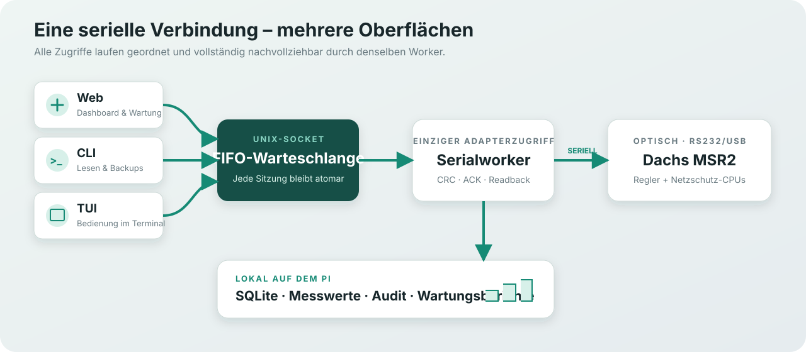

# Open Dachs Manager · V3 1.8.18

Lokale Bedienung, Überwachung und Wartungsdokumentation für Dachs-Anlagen mit
MSR2-Regler – über die optische serielle Schnittstelle und ohne Cloud-Zwang.

> **Projektstatus: Version 1.8.18.** Lesen, Dekodieren, Wartungs-Testmodus und der
> zentrale Serialworker sind an einer Anlage praktisch erprobt. Ein echter
> Schreibvorgang erfordert immer die ausdrückliche Schreibfreigabe,
> Authentifizierung, eine positive Antwort und die anschließende Rückleseprüfung.

Open Dachs Manager ist ein unabhängiges Open-Source-Community-Projekt.



## Was ist enthalten?

| Bereich | Funktionen |
|---|---|
| **Übersicht** | Dachs Ein/Aus und Entstören als getrennte geschützte Adminaktionen, Wirkleistung Ist/Soll mit automatisch berechnetem PW4, Betriebsstunden je Start direkt aus Reglerblock 38, reale Laufzeit seit Start aus der Motorstatus-Historie mit dem validiert gelesenen Reglerzähler `0x0f0e` und dessen Schwellen 6 h (Nachtabschaltung) und 24 h als Unterzeile, Wartungsrestzeit, frei auswählbare Live-Kacheln und technisches Anlagenbild mit Rußfilterschätzung |
| **Bedienplatz** | Auf 1366 × 768 optimierte Touch-Ansicht mit derselben technischen Anlagenübersicht und gemeinsamem 2-Stunden-Verlauf für Drehzahl, Wirkleistung und Motorabgas |
| **Überwachung** | Live-Werte und Historien mit Stunden-/Datumsauswahl, gemeinsamer Zeitachse und Zoom, Laufzustandsbändern sowie ereignistreuer Block-24-Motorstatusleiste |
| **Wartung** | Vollständiges 42-Ziele-Pflichtbackup, schreibfreier Gesamtsnapshot, digitale Checkliste, PW4-Leseknopf, Vorher-/Nachher-Werte und PDF/HTML/JSON |
| **Backup** | Geschütztes Wartungsarchiv, 36 Reglerblöcke sowie Block 16/20/21 beider Netzschutz-CPUs sichern; ausschließlich die 36 Reglerblöcke lassen sich im Dry-Run oder kontrolliert wiederherstellen |
| **Einstellung** | Vollständig dekodierte Register, kontrollierte Schreibvorgänge sowie je Netzschutz-CPU Legacy-Schutz, zusätzliche Schutzparameter und Live-Netzwerte |
| **System** | Mehrere Benutzer, optionaler lokaler Bedienplatz, Rollen, Passwortverwaltung, API-Freigabe, Token-Manager, standardmäßig deaktivierte SMTP-Benachrichtigungen mit auswählbaren Kategorien und Textvorlagen, offline prüfendes Firmware-Center und fail-closed erkannte SC123-Grenze für die passende einstellbare Firmware |
| **Werkzeuge** | Weboberfläche, CLI, TUI, JSON-Backups, Audit-Protokoll und systemd-Dienste |

Weitere Merkmale:

- lokaler Betrieb auf Raspberry Pi oder einem vergleichbaren Linux-System
- beliebig viele lokale Gast- und Admin-Konten mit gesalzenen Passwort-Hashes
- Token-geschützte HTTP-API für EDOMI; HTTPS kann vor dem Dienst durch nginx
  terminiert werden
- zentrale kompakte SQLite-Historie: 21 ausgewählte Betriebs- und Messwerte
  aus Block 22/24 gemeinsam in einem Snapshot je Livezyklus sowie getrennte
  Wartungs- und Auditprotokolle
- zusätzliche adaptive Historie für alle regulär überwachten Livewerte:
  24 Stunden Rohdaten, volle Auflösung für Motorlauf plus je eine Stunde Vor-
  und Nachlauf, 15-Minuten-Verdichtung für übrige Stillstandszeiten
- ein gemeinsamer FIFO-Serialworker für Web, CLI und TUI
- atomare Abläufe für Wartungssnapshots und `Auth → Write → ACK → Readback`
- geschütztes Backup-Archiv: Jeder Wartungsstart verlangt ein vollständiges,
  SHA-256-geprüftes Abbild aller 42 Sicherungsziele; ausschließlich 36
  Reglerblöcke bleiben wiederherstellbar
- umschaltbarer Testmodus: Wartung vollständig durchspielen und lokal
  abschließen, ohne den Regler zu verändern; nur ein Admin kann den
  kontrollierten Echtabschluss freischalten
- getrennte Adressierung von Regler-CPU sowie Netzschutz-CPU 1 und 2
- Installation und Aktualisierung mit einem Skript
- integrierter deutscher Klartextkatalog im eigenen Open-Dachs-JSON-Schema;
  aktive Fehler erscheinen zum Beispiel als `SC 163 · Leistung zu klein`
- manueller Admin-Entstörknopf nur bei aktiver Störung und sicher bestätigtem
  Stillstand sowie ausdrücklich fachlich freigegebener installationsbezogener
  Temperatur-/Wiederanlaufpolitik: frische doppelte Zustandslesung,
  Störereignisbindung, Auth 3, genau eine flüchtige Quittierung, exaktes
  ACK/Echo, stabiler Servicecode-0-Readback, Auth-0-Cleanup, bestätigungsfestes
  Einmaltoken, persistenter Neustartschutz und Audit ohne PW4
- getrennte Adminaktionen `Dachs Ein` und `Dachs Aus` für das flüchtige
  Automatikfreigabebit: feste Adresse und Auth 3, doppelte Direktlesung,
  byteerhaltendes Lesen-Ändern-Schreiben, genau ein Telegramm, doppelte exakte
  Rücklesung und keine automatische Verkettung mit `Entstören`; Ein ist kein
  Zwangsstart, Aus kein Not-Aus
- optionaler lokaler Diagnosekatalog für zusätzliche Ursachen und Maßnahmen;
  diese Quelldatei wird nicht in das öffentliche Repository kopiert
- geschätzter Rußfilter-Füllstand aus einer lokal einstellbaren
  Motorabgastemperatur-Kennlinie; reine Anzeige ohne Regler-Write

## Einblicke

### Überwachung und Historie

Die Schnellbereiche umfassen 1, 2, 3, 4, 5, 6, 8, 10, 12, 16, 24 und
48 Stunden. Alternativ lassen sich 1 bis 720 freie Stunden per Button oder
Enter bestätigen oder Start und Ende mit Datum und Uhrzeit festlegen.
Temperatur-, Motor-, Motorstatus- und Abgasdiagramm verwenden immer denselben
Zeitraum; ein mit der Maus gezogener Zoom gilt deshalb gleichzeitig für alle
vier.
Helle grüne und rote Hintergründe kennzeichnen anhand der bereits erfassten
Drehzahl Lauf und Stillstand. Datenlücken bleiben ohne Zustandsfarbe.
Die eigene Block-24-Statusleiste zeigt Aus weiß, Startvorbereitung orange,
Start/Anlasser rot, Lauf grün und Abschaltroutinen violett. Jeder Statuswechsel
der im etwa 0,75-sekündigen Lesezyklus beobachtet wird, bleibt unabhängig von
der Kurvenreduktion erhalten; beim Darüberfahren stehen Statusnummer und
Originaltext im Hinweis. Aufzeichnungslücken sind schraffiert.

Block 24 liefert außerdem die Zustände 33/34/35 und die Signale
`sStellmotorGas`/`sStellmotorOel`. Das sind Ansteuerung beziehungsweise
Bewegungsrichtung (`zu`/`aus`/`auf`), **keine absolute Stellmotorposition**;
eine Winkel- oder Weg-Rückmeldung ist im gemappten MSR2-Bestand nicht vorhanden.

### 250-h-Diagnose

Der Reiter `250-h-Diagnose` rekonstruiert 250-Betriebsstunden-Intervalle und
Trends ausschließlich aus der bereits vorhandenen lokalen SQLite-Historie. Er
liest keine MSR2-Diagnoseblöcke, authentifiziert nicht und schreibt nicht. Ein
eigener Hintergrundworker aktualisiert einen atomar gespeicherten privaten
Cache bei Dienststart, lokaler Mitternacht, erkanntem Motorstopp und manueller
Aktualisierung; API und Oberfläche liefern währenddessen sofort den letzten
gültigen oder einen klar markierten Pending-/Stale-Zustand.

Die Auswertung trennt Datenlücken, Normalbänder und Trendhinweise. Fehlstarts
bleiben ausdrücklich nicht verfügbar, solange keine dafür belegte interne
Zeitreihe existiert; Motorstatus 14 wird nicht als Fehlstart oder bestätigter
Stopp umgedeutet. Die Rußfilteranzeige und ihre lokale Kennlinie bleiben davon
unabhängig.

### Geführte Wartung

Beim Start liest eine einzige gemeinsame serielle Sitzung alle 42
CPU-/Blockziele. Derselbe eingefrorene Lesezustand speist gleichzeitig das
vollständige, geprüfte Backup und den Anlagenstand des Wartungsberichts; eine
zweite Blockrunde ist nicht nötig. Checkliste, Messwerte und Bemerkungen werden
automatisch gespeichert. Im standardmäßig aktiven
Testmodus bleibt der Regler auch beim Abschluss unverändert. Ein Admin kann
den Modus persistent unter `System → Wartungsabschluss` umschalten; der Echtabschluss
verlangt weiterhin PW4, exakte Bestätigung, positives ACK und Readback.
Zusätzlich kann ein Admin einen offenen Entwurf mit Pflichtgrund als lokale **Zwischenwartung** abschließen. Ihre dauerhaft gespeicherte Nummer basiert auf dem eingefrorenen Regler-Wartungszähler (zum Beispiel `4.1`, danach `4.2`); fehlt der Zähler, gilt als stabile Basis der höchste bereits gespeicherte Zwischenwartungs-/Snapshot-Stand, andernfalls `0`. Dieser Sonderweg nutzt weder Authentifizierung noch Serialworker und verändert Block 100, Block 104 und den Dachs nicht. Grund und Nummer erscheinen in Liste, Bericht und allen Exporten.

Offene und abgeschlossene Wartungsberichte können nach einer Sicherheitsabfrage
gelöscht werden; das verknüpfte Backup bleibt im geschützten Archiv erhalten.
Ein bereits erfolgter Reglerabschluss und das Schreib-Audit bleiben ebenfalls
unberührt. Ein Abschluss mit Zustand `Abschluss läuft` darf nicht wiederholt
oder gelöscht werden; `Zielzustand unklar` verlangt eine fachliche Prüfung.



### Kompakter Wartungsbericht

Der Bericht fasst Anlagenstand, Prüfpunkte, Vorher-/Nachher-Messwerte und das
Ergebnis kompakt zusammen. Backup-ID, Erstellzeit, 42/42-Sicherungsergebnis,
die 36 Restore-Ziele und Abbild-SHA-256 sind Teil der Herkunftsinformation. Ein technischer
Anlagenanhang kann zusätzlich ausgegeben werden.

<p align="center">
  
</p>

### Einstellungen und Netzschutz

Die beiden Überwachungs-CPUs besitzen eigene Blockräume. Netzschutzwerte sind
deshalb klar rot gekennzeichnet. Je CPU sind drei live bestätigte Blöcke
getrennt sichtbar: Block 16 mit dem 18-Byte-Legacy-Schutzlayout, Block 20 mit
39 Schutzparametern aus 59 Byte und Block 21 mit 28 dreiphasigen Live- und
Diagnosewerten aus 56 Byte.

Legacy-Block 16 ist nach den neueren Livebefunden ebenfalls nur lesbar: Beide
U-3.050-CPUs lehnten sogar die unveränderte Vollblock-Rücksicherung fachlich
mit `7F 11 01` ab; vier Rücklesungen blieben bytegleich. Block 20 ist trotz des aus der Layout-4-Datenzuordnung abgeleiteten Dienstes 21
nur lesbar: Ein minimaler physischer Test auf beiden U-3.050-CPUs gewährte
Auth 5 und lieferte einen positiven ACK, der Wert blieb aber nach vier
Readbacks unverändert. Open Dachs Manager wertet einen ACK deshalb nicht als
Schreiberfolg und bietet B20 nicht mehr zur Bearbeitung an.

Block 21 besitzt keinen Schreibdienst und bleibt als laufender Messwertblock
strikt nur lesbar. Backups erfassen Block 20 und 21 beider Netzschutz-CPUs
zusätzlich schreibfrei, damit Schutzkonfiguration und Diagnosezustand im
Abbild vollständig nachvollziehbar sind. Wiederherstellbar bleiben ausschließlich die 36 Reglerblöcke. Block 16, 20
und 21 beider Netzschutz-CPUs sind read/backup-only und werden vor jeder
seriellen Sitzung, Authentifizierung oder Restoreauswahl abgewiesen. Die
geprüften Standarddefinitionen enthalten keine weiteren Netz-CPU-Datenblöcke.
Die zusätzlich live gelesenen Diagnosedienste 17 und 18 werden mangels belegter
Feldstruktur nur als Rohbefund geführt, nicht als dekodierte Felder angeboten.

Unter `System → Firmware` prüft das Firmware-Center eine `.muc` vollständig
offline auf Header, Längen, SHA-256 und die acht eingebetteten Modulabbilder.
Die Datei wird nicht gespeichert und die serielle Schnittstelle nicht berührt.
Der native Live-Flash bleibt gesperrt, bis Loader-Kommandos, Baudwechsel,
Frame-/ACK-Regeln und Abschlussprüfung des Golden Trace vollständig verifiziert
sind; bis dahin bleibt der originale Updater über die kontrollierte
COM3/RFC2217-Brücke der freigegebene Flashweg.

Mit einer separat installierten, passenden einstellbaren R-000.004.043-Firmware
zeigt derselbe Reiter zusätzlich die persistente SC123-Abgasgrenze von 180 bis
240 °C. ODM schaltet die Bedienung nur frei, wenn zwei frische Block-50-Lesungen
den exakten +1-Heartbeat der Patch-Firmware zeigen und zwei Block-60-Lesungen
bytegenau stabil sind. Der Grenzwert liegt als versionierter Datensatz mit
Kennung, Wert und Komplement in Block 60; ein ungültiger Datensatz bedeutet
Firmware-Fallback 180 °C. Der Browser kann weder Adresse noch Auth-Level oder
PW4 vorgeben. Der Server bindet die Vorschau an den vollständigen
Block-60-Ausgangszustand, führt Auth 3, höchstens einen Block-60-Schreibvorgang,
eine RAM-Rücklesung, eine begrenzte persistente NVM-Prüfung über Lesedienst
0x04, Auth 0 und Audit aus. Nach Rückflash auf Stock-Firmware fehlt der
Heartbeat und die Bedienung bleibt automatisch gesperrt. Historisch belegt sind
nur 180 und 200 °C; 201–240 °C sind technisch einstellbar, aber nicht
herstellerseitig oder thermisch live validiert. ODM installiert oder flasht
diese Firmware nicht.



### Systemverwaltung und EDOMI-API

`System` ist ein eigener, nur für Admins sichtbarer Hauptbereich. Dort werden
Benutzer, Rollen, Passwörter, API-Schreibfreigabe und Tokens verwaltet; die
Dachs/MSR2-Register bleiben davon vollständig getrennt. Tokens besitzen
unabhängige Rechte für `read`, `history` und `write` und werden nur einmal im
Klartext angezeigt.

Der Unterbereich `E-Mail` konfiguriert Benachrichtigungen für Wartung, neue
Fehler, ohne bestätigte ODM-Entstörung verschwundene Fehler und bewusst
gesetzte Temperaturgrenzen. Betreff und Text sind je Kategorie editierbar.
Versand ist standardmäßig aus und läuft aus einer persistenten SQLite-Outbox
in einem eigenen Thread; der Serialworker wird dafür weder geöffnet noch
blockiert.

Für einen direkt am Server betriebenen Touch-Bedienplatz kann dort zusätzlich
ein lokaler Benutzer aktiviert werden. Er lauscht auf einem frei wählbaren
Port ausschließlich an `127.0.0.1`; Standard sind Port 80 und die Rolle
`admin`, die Funktion selbst ist standardmäßig deaktiviert. Der normale
Web-Port und jeder Reverse Proxy bleiben loginpflichtig. Der lokale Principal
ist cookie-los, und `/api/v1/*` verlangt weiterhin einen Bearer-Token.

EDOMI sendet beim Schreiben ausschließlich einen technischen Key und den
logischen Zielwert. Blockkodierung, PW4, Authentifizierung, positives ACK,
Readback und Audit verbleiben serverseitig im Open Dachs Manager. Rohe
Blockpayloads oder PW4 werden nicht über die API entgegengenommen.
Die frei definierbaren Protokollbytewerte sind für Bedien- und API-Schreibwege
typstreng auf Auth-Level 1 bis 5 begrenzt. Die Originaloberfläche benennt die
Rollen 1 bis 4; die älteren V2-Schreib- und Backup-Werkzeuge verwenden
zusätzlich Level 5. Höhere Bytewerte werden trotz möglichem Reglerecho nicht
als weitere Berechtigungsstufen akzeptiert.

## Warum ein zentraler Serialworker?



Nur der Worker öffnet den optischen Adapter. Eine komplette Client-Sitzung ist
genau ein Eintrag in der FIFO-Warteschlange. Dadurch können Weboberfläche, CLI
und TUI gleichzeitig laufen, ohne dass sich serielle Telegramme überlagern.

Die technische Struktur der Telegramme, CRC, CPU-Zieladressen sowie Lese- und
Schreibsequenzen sind in der eigenständigen
[MSR2-Protokollanalyse](docs/PROTOKOLL.md) dokumentiert.

## Benötigter Lesekopf

Aktuell getestet und unterstützt ist ein **optischer USB-Lesekopf** für die
lokale Schnittstelle nach DIN EN 62056-21 beziehungsweise IEC 62056-21.

Günstiges Beispiel:
[ELV USB-IEC, Artikel 158713](https://de.elv.com/p/elv-lesekopf-mit-usb-schnittstelle-fuer-digitale-zaehler-usb-iec-P158713/).
Andere kompatible USB-Leseköpfe sollten ebenfalls funktionieren. Der Manager
spricht unter Linux ein serielles Gerät wie `/dev/ttyUSB0` oder einen stabilen
Pfad unter `/dev/serial/by-id/` an. Ein klassischer RS232-Lesekopf könnte mit
passendem Linux-Gerätepfad funktionieren, ist derzeit aber nicht praktisch
getestet.

Die Normangabe beschreibt die optische Schnittstelle des Lesekopfs. Das
binäre MSR2-Protokoll selbst ist kein Stromzählerprotokoll nach IEC 62056-21.

## Schnellinstallation

Voraussetzungen: Debian, Raspberry Pi OS oder ein vergleichbares Linux mit
systemd, Internetzugang und ein angeschlossener USB-Lesekopf. Fehlende
Systempakete wie Python, venv und pip installiert `install.sh` auf Debian und
Raspberry Pi OS automatisch.

```bash
git clone https://github.com/x3muha/open-dachs-manager.git
cd open-dachs-manager
sudo ./install.sh
```

Falls die automatische Geräteerkennung nicht eindeutig ist:

```bash
sudo ./install.sh \
  --serial-port /dev/serial/by-id/usb-FTDI_USB__-__Serial-if00-port0
```

Die Fehler-Klartexte sind bereits integriert. Ein lokal vorhandener deutscher
Diagnosekatalog kann zusätzlich Ursachen und Maßnahmen ergänzen:

```bash
sudo ./install.sh \
  --service-codes-file /pfad/zu/Servicecodes_de.properties
```

Für einen Reverse-Proxy-Subpfad lässt sich zusätzlich beispielsweise
`--base-path /dachs` setzen. Ohne diese Option bleibt die bisherige Root-URL
unverändert.

Der Installer richtet einen eigenen Systembenutzer, eine isolierte
Python-Umgebung, geschützte Konfiguration, lokales Datenverzeichnis und zwei
systemd-Dienste ein. Die zufällig erzeugten Erstpasswörter werden einmalig
angezeigt. Danach ist die Oberfläche standardmäßig hier erreichbar:

```text
http://<adresse-des-pi>:8084
```

Ausführlich: [Installationsanleitung](docs/INSTALLATION.md) ·
[Bedienungsanleitung](docs/BEDIENUNGSANLEITUNG.md)

## Nützliche Befehle

```bash
open-dachs doctor
open-dachs list-blocks --addressable-only
open-dachs read block --block 20
open-dachs read decoded --blocks 20,22,24,26
open-dachs backup create --all-blocks --output open-dachs-backup.json
open-dachs tui --block 20 --all-blocks --dry-run
```

Dienststatus und Protokolle:

```bash
sudo systemctl status \
  open-dachs-manager-serial.service \
  open-dachs-manager-web.service

sudo journalctl \
  -u open-dachs-manager-serial.service \
  -u open-dachs-manager-web.service -f
```

Mehr dazu: [Betrieb und Fehlersuche](docs/OPERATIONS.md)

## Entwicklung

```bash
python3 -m venv .venv
. .venv/bin/activate
python -m pip install -e .
python -m unittest discover -s tests -p 'test_*.py'
python -m compileall -q src tests
```

Die Tests verwenden simulierte Transporte und benötigen keinen angeschlossenen
Regler. Live-Lesevorgänge und Live-Schreibvorgänge bleiben getrennte,
absichtliche Arbeitsschritte.

## Sicherheit

Die physische Verbindung ist ausschließlich seriell. Neben dem Worker darf
kein zweites Programm den Adapter direkt öffnen. Jeder echte Schreibvorgang
folgt diesem Ablauf:

```text
Lesen → Validieren → Auth/PW4 → Schreiben → positives ACK → Readback → Audit
```

Vor dem Aktivieren von Schreibvorgängen bitte das
[Sicherheitsmodell](docs/SAFETY.md) lesen.

## Mitmachen und Lizenz

Quellcode und Dokumentation dieses Repositories stehen unter der
[MIT-Lizenz](LICENSE). Das vom Anlagenbetreiber bereitgestellte technische
Visualisierungsbild ist davon ausgenommen; Herkunft und Nutzungsgrenze stehen
in den [Asset-Hinweisen](docs/ASSETS.md). Externe Python-Pakete werden bei der
Installation aus ihren jeweiligen Projekten bezogen und nicht in diesem
Repository mitgeliefert; siehe [Abhängigkeiten](DEPENDENCIES.md).

Beiträge sind willkommen. Die technischen Anforderungen stehen in
[CONTRIBUTING.md](CONTRIBUTING.md).

## Signierte Aktualisierungen ab 1.8.17

ODM prüft im Hintergrund ausschließlich das feste öffentliche Repository
x3muha/open-dachs-manager auf neuere stabile Releases. Ein Update besteht aus
kanonischem Manifest, Ed25519-Signatur und exakt benanntem Universal-Wheel. Die
Webanwendung prüft Signatur, SHA-256 und Wheel-RECORD, installiert aber nie
selbst. Erst eine passwortbestätigte Admin-Vorschau und die exakte Bestätigung
erzeugen eine einmalige Anfrage an den root-eigenen systemd-Helfer.
Automatische Updates sind standardmäßig aus und erfordern einen sichtbaren
Opt-in; sie warten mindestens 48 Stunden und laufen nur im Wartungsfenster
02:00–04:00 Europe/Berlin. Bei einem Fehler wird die Automatik abgeschaltet.
